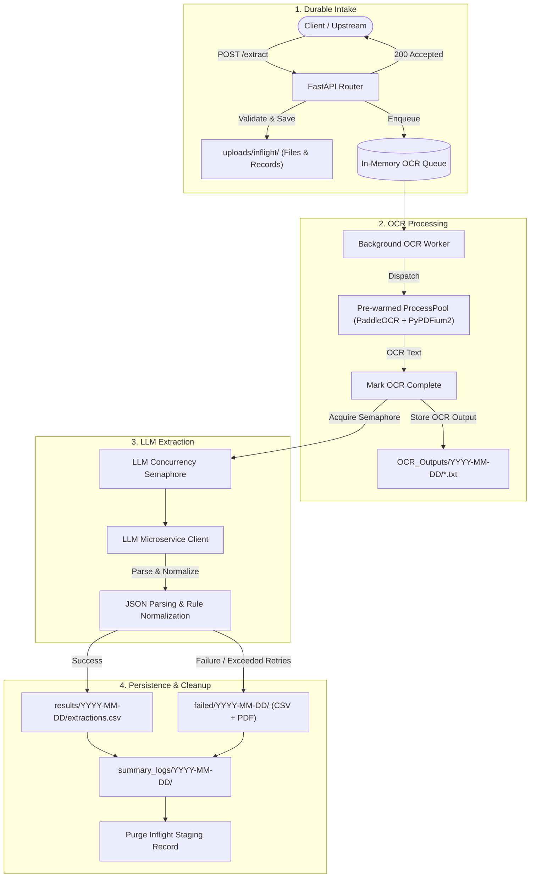

# Intelligent Document Extraction System

An asynchronous, fault-tolerant PDF document extraction pipeline built with **FastAPI**, **PaddleOCR**, and **LLM** integration. The system implements a "Submit & Forget" queueing architecture to extract key financial and customer entities from documents with durable file tracking, crash-resilient lifecycles, and automated retention management.

---

## 📑 Table of Contents

- [Overview & Architecture](#-overview--architecture)
- [Key Features](#-key-features)
- [Extracted Entities](#-extracted-entities)
- [System Requirements](#-system-requirements)
- [Installation & Setup](#-installation--setup)
- [Configuration (.env)](#-configuration-env)
- [Running the Application](#-running-the-application)
- [API Reference](#-api-reference)
- [Directory Structure & Storage Layout](#-directory-structure--storage-layout)
- [Production Deployment (Systemd)](#-production-deployment-systemd)
- [Failure Handling & Resiliency](#-failure-handling--resiliency)

---

## 🏗 Overview & Architecture

The system processes incoming PDF documents asynchronously in a multi-stage pipeline:



---

## ✨ Key Features

- **Submit & Forget (Async Queueing)**: Endpoints return immediately (`200 OK`) once the file is durably accepted, freeing upstream clients while worker tasks process in the background.
- **Pre-warmed Multiprocessing OCR**: Isolates CPU-heavy PaddleOCR operations inside a dedicated worker process pool to prevent blocking FastAPI's async event loop.
- **Crash Resilience & Recovery**: In-flight uploads and stage states are durably stored on disk (`uploads/inflight/`). On server reboot/restart, pending and interrupted files are automatically recovered and resumed.
- **LLM Rate Limiting & Concurrency Control**: Semaphore-controlled concurrency with automatic exponential backoff retries.
- **Multi-Strategy JSON Extraction**: Resilient parsing pipeline capable of parsing markdown code blocks, bracket-delimited objects, and automatically repairing truncated JSON streams.
- **Automated Data Retention**: Automatic cleanup enforcing retention policies (default: 90 days) across extraction results, failed uploads, OCR text files, and summary logs.
- **Production-Ready Logging & Metrics**: Generates detailed, structured summary logs per run alongside fixed-width CSV exports.

---

## 🎯 Extracted Entities

The extraction pipeline captures and normalizes the following target fields:

| Field Name | Description |
| :--- | :--- |
| `name` | Account holder or entity name |
| `master_account_number` | Primary account number |
| `sub_account_number` | Sub-account number (if present) |
| `fi_num` | Financial Institution (FI) code |
| `bank_name` | Name of the banking institution |

---

## ⚙️ System Requirements

- **Operating System**: Linux (Ubuntu 20.04+ recommended) / macOS / Windows
- **Python**: 3.10+
- **System Dependencies**: `libgl1` / `libglib2.0-0` (required for OpenCV / PaddleOCR)

---

## 🚀 Installation & Setup

### 1. Clone the Repository
```bash
git clone <repository-url>
cd Intelligent-Document-Extraction-System
```

### 2. Create and Activate Virtual Environment
```bash
python3 -m venv .venv
source .venv/bin/activate
```

### 3. Install Dependencies
```bash
pip install --upgrade pip
pip install -r requirements.txt
```

---

## 🔧 Configuration (.env)

Create a `.env` file in the root directory (or configure via environment variables):

```ini
# Application
APP_NAME="LLM Extraction Service"
APP_VERSION="1.0.0"
DEBUG=false

# LLM Microservice Settings
LLM_BASE_URL="http://your-llm-service-host:port"
LLM_EXTRACT_ENDPOINT="/v1/chat/completions"
LLM_API_KEY=""
LLM_MODEL_NAME="your-model-name"
HELPER_ID=""
LLM_TIMEOUT_SECONDS=600.0
LLM_MAX_CONCURRENT=3
LLM_MAX_RETRIES=2
LLM_RETRY_BASE_BACKOFF=2.0
MAX_TOKENS=2048

# OCR Configuration
OCR_TIMEOUT_SECONDS=300.0

# Input Safety & Limits
MAX_INPUT_CHARACTERS=50000
MAX_UPLOAD_BYTES=10485760             # 10 MB
EXTRACT_MAX_PENDING_TASKS=50
EXTRACT_SHUTDOWN_DRAIN_SECONDS=30.0

# Retention Policy
RETENTION_MAX_DAYS=90
```

---

## 🏃 Running the Application

### Development Mode
```bash
python main.py
```
*The server will start at `http://127.0.0.1:5000` with hot-reload enabled.*

### Production Mode (Uvicorn)
```bash
uvicorn app.main:app --host 0.0.0.0 --port 5000 --workers 1
```
*(Note: Run with `--workers 1` when using internal queue workers and process pools).*

---

## 📡 API Reference

### 1. Health Check
Check service health and availability.

- **URL**: `/health`
- **Method**: `GET`
- **Response**:
```json
{
  "status": "ok"
}
```

---

### 2. Queue Document for Extraction
Submits a PDF file to the asynchronous extraction pipeline.

- **URL**: `/extract`
- **Method**: `POST`
- **Content-Type**: `multipart/form-data`
- **Parameters**:
  - `file`: PDF file binary (`.pdf`, max 10MB)

#### Example Request (`curl`)
```bash
curl -X POST "http://127.0.0.1:5000/extract" \
     -F "file=@/path/to/statement.pdf"
```

#### Responses:
- **`200 OK`** (Accepted and queued):
```json
{
  "success": true,
  "message": "File queued successfully."
}
```
- **`422 Unprocessable Entity`** (Validation failure):
```json
{
  "success": false,
  "message": "Invalid file type. Only .pdf files are accepted."
}
```
- **`503 Service Unavailable`** (Queue capacity exceeded):
```json
{
  "success": false,
  "message": "Server is at capacity. Please retry shortly."
}
```

---

## 📂 Directory Structure & Storage Layout

```text
├── app/
│   ├── core/
│   │   └── config.py               # Application settings & environment validation
│   ├── features/
│   │   ├── extraction/
│   │   │   ├── concurrency.py      # Queues, locks, process pool & semaphores
│   │   │   ├── context.py          # FileProcessingContext data class
│   │   │   ├── lifecycle.py        # Durable intake, recovery & cleanup
│   │   │   ├── normalization.py    # Normalizers for FI codes & account numbers
│   │   │   ├── pipeline.py         # OCR & LLM extraction workers
│   │   │   ├── retention.py        # Automated file retention cleaner
│   │   │   ├── router.py           # /extract endpoints
│   │   │   ├── storage.py          # Output CSV/TXT file writers
│   │   │   └── summary_logs.py     # Execution audit logs
│   │   └── prompt.py               # LLM prompt templates & guidelines
│   ├── models/
│   │   └── schemas.py              # Pydantic models for inputs & outputs
│   ├── services/
│   │   ├── file_service.py         # File validation & reading
│   │   ├── llm_client.py           # HTTP client & JSON output normalizers
│   │   └── paddle_ocr.py           # PaddleOCR integration & PDF rasterization
│   └── main.py                     # FastAPI application & lifespan management
├── FileReader.service              # Systemd unit file template
├── main.py                         # Application entrypoint
├── requirements.txt                # Python dependencies
└── Storage Outputs (Generated at runtime):
    ├── uploads/inflight/           # Durable intake storage (cleaned up on finish)
    ├── results/YYYY-MM-DD/         # extractions.csv (successful extractions)
    ├── failed/YYYY-MM-DD/          # failed.csv & failed PDF copies
    ├── OCR_Outputs/YYYY-MM-DD/     # Raw OCR output text per file
    └── summary_logs/YYYY-MM-DD/    # Detailed execution logs & performance metrics
```

---

## 🖥 Production Deployment (Systemd)

A systemd service unit file is provided at [`FileReader.service`](file:///home/j03f/Projects/Public_Bank/Intelligent-Document-Extraction-System/FileReader.service).

### 1. Configure the Service File
Edit `FileReader.service` to match your deployment directory and user:
```ini
[Unit]
Description=Intelligent Document Extraction System
After=network.target

[Service]
Type=simple
User=your-user
Group=your-group
WorkingDirectory=/path/to/Intelligent-Document-Extraction-System
EnvironmentFile=/path/to/Intelligent-Document-Extraction-System/.env
ExecStart=/path/to/Intelligent-Document-Extraction-System/.venv/bin/uvicorn app.main:app --host 127.0.0.1 --port 5000 --workers 1
Restart=on-failure
RestartSec=5
TimeoutStopSec=45
KillSignal=SIGTERM

# Hardening
NoNewPrivileges=true
ProtectSystem=full

[Install]
WantedBy=multi-user.target
```

### 2. Enable and Start the Service
```bash
sudo cp FileReader.service /etc/systemd/system/
sudo systemctl daemon-reload
sudo systemctl enable FileReader
sudo systemctl start FileReader
```

### 3. Check Service Status & Logs
```bash
sudo systemctl status FileReader
sudo journalctl -u FileReader -f
```

---

## 🛡 Failure Handling & Resiliency

- **Process Isolation**: The OCR worker executes inside a separate process. If a PDF causes a segmentation fault or native library crash, the main web service catches `BrokenExecutor`, recreates the pool, and records the failure cleanly without crashing the API.
- **Graceful Shutdown**: Upon receiving `SIGTERM`, the service drains pending and active extractions up to `EXTRACT_SHUTDOWN_DRAIN_SECONDS` before shutting down.
- **Crash Recovery**: If the system terminates abruptly, the intake files recorded in `uploads/inflight/` are re-read upon next startup:
  - Files that completed OCR will resume straight to LLM extraction.
  - Files that were queued or in OCR will re-queue for full OCR and extraction.
- **Retention Management**: Built-in retention enforcement prunes dated directories older than `RETENTION_MAX_DAYS` at the start of each write operation.
